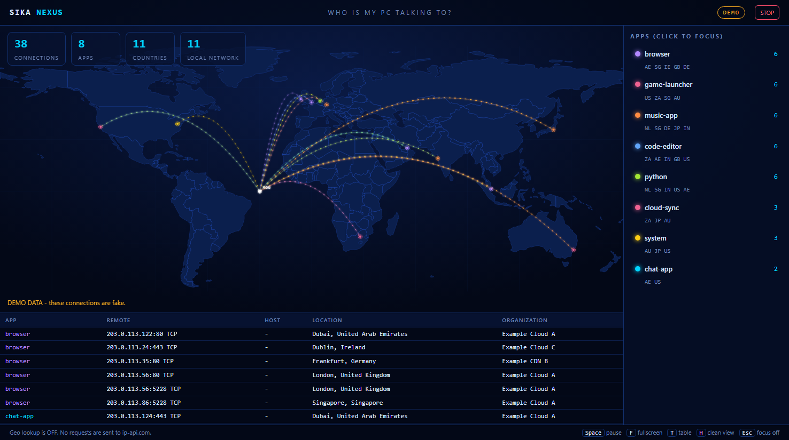

# Who Is My PC Talking To?

[](https://www.python.org/) [](LICENSE) [](https://www.youtube.com/@SikaNexus)

A local network connection dashboard by Sika Nexus. It shows remote internet connections made by your computer, the process associated with each connection when available, and optional approximate locations on a map.

## What does this tool do?

The tool reads connection metadata from your operating system and displays it in a browser dashboard running on your own computer. It does **not** capture packets or inspect message contents. Process names may appear as `unknown` or a PID when the operating system does not provide a name.

## Screenshot

The screenshot uses the built-in demo mode. Its connections, addresses, and locations are synthetic; no live network data is shown.



## Requirements and installation

The repository includes `run.bat` for Windows and `run.sh` for macOS and Linux. Double-click `run.bat` on Windows, or run `sh run.sh` in a terminal on macOS or Linux.

Python 3.9 or later and `psutil` are required. Install the dependency with:

```sh
python -m pip install -r requirements.txt
```

You can also install it directly with `pip install psutil`.

## Run

```sh
python who_is_my_pc_talking_to.py
```

The dashboard opens at [http://127.0.0.1:8765](http://127.0.0.1:8765). To stop it, press Ctrl+C in the terminal or use the **STOP** button in the dashboard.

On Windows, some connections owned by system services or other users may only be visible when Command Prompt or PowerShell is opened with **Run as administrator**. On macOS and Linux, run with `sudo` for the best connection visibility:

```sh
sudo python3 who_is_my_pc_talking_to.py
```

## Options

| Option | Description |
| --- | --- |
| `--port N` | Use a local port from 1 to 65535 (default: 8765). If it is already in use, choose another port such as `--port 8800`. |
| `--no-geo` | Never contact `ip-api.com`. Real scans still show the connection list, without a map. Demo mode uses built-in sample locations and can still show its map. |
| `--no-browser` | Do not open the dashboard in a browser automatically. |
| `--demo` | Show fictional sample connections and locations. Demo mode does not scan real connections or contact the geolocation service. |

For example:

```sh
python who_is_my_pc_talking_to.py --demo
```

## Privacy

**When geolocation is enabled (the default), remote IP addresses are sent to `ip-api.com` to look up approximate locations and network organizations.** The tool also requests your own public IP's location from that service so it can place the “YOU” marker. These lookups use the service's plain HTTP endpoint and are subject to its service limits (15 requests per minute). Geolocation failures do not stop the connection list from working.

The tool reads connection metadata only: process name (if available), remote IP address, port, and protocol. **It does not sniff packets, capture traffic, or read the contents of network communications.** The dashboard listens on `127.0.0.1` and is intended for local use. Use `--no-geo` to prevent all requests to ip-api.com. Reverse hostname lookups use your system DNS resolver and may send the remote IP address to that resolver; they can still occur when `--no-geo` is enabled.

If you use a VPN, the “YOU” marker reflects the location reported for the VPN's public exit IP, not your actual physical location.

**Use this tool to monitor your own computer only. Do not monitor someone else's device without their permission.**

## License

This project is distributed under the [MIT License](LICENSE).

## Platform notes

Application names are supplied by the operating system and vary between platforms. Names such as `svchost` are Windows-specific; on other systems, names may differ or be unavailable. The dashboard remains usable when a process name cannot be determined.

## How it works

1. **Scanning:** `psutil` reads active network connections from the operating system, including the owning process when available.
2. **DNS and geolocation:** The tool resolves hostnames with reverse DNS lookups and requests approximate locations from `ip-api.com` in batches. Geolocation requests are spaced to stay within the service's rate limit.
3. **Dashboard:** Python's `http.server` serves a local single-page app built with HTML, CSS, and JavaScript. The page plots connections on an SVG world map.
